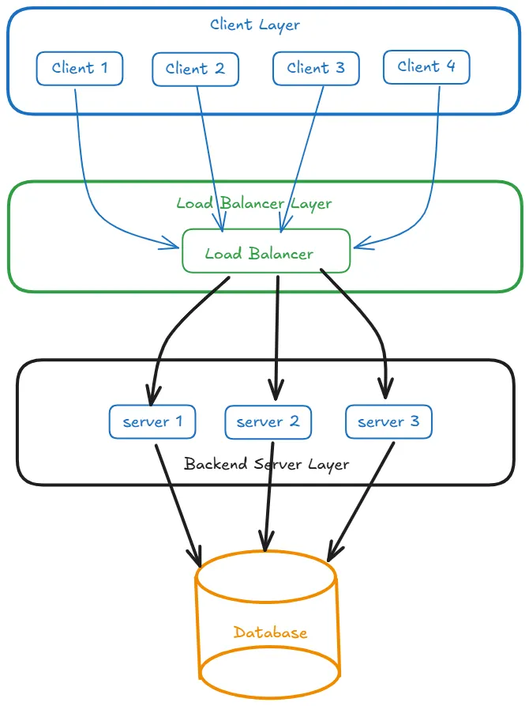

A load balancer distributes incoming network traffic across multiple servers to ensure that no single server is overloaded, and the traffic is uniformly distributed. This improves the application availability, scalability, performance and the reliability.

Types of load balancer
By OSI Layer: Layer 4 & Layer 7
A load balancer can operate at transport layer (Layer 4) or at the application layer (Layer 7).

A layer 4 load balancer routes the request based on IP address and port. This load balancers are fast and works with TCP or UDP protocols. An example of layer 4 load balancer is AWS Network Load Balancer (NLB).

A layer 7 load balancer operates on the application layer and routes the incoming request based on the content, such as HTTP headers, URLs, cookies, and so on. It can make more intelligent routing decisions as it operates on the application layer, and it can also modify the HTTP request and the response. This load balancer performs slower than the layer 4 load balancer due to the HTTP processing overhead.